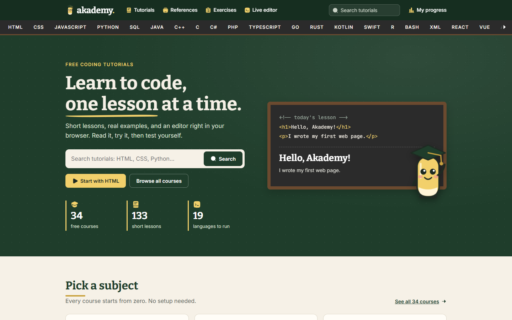
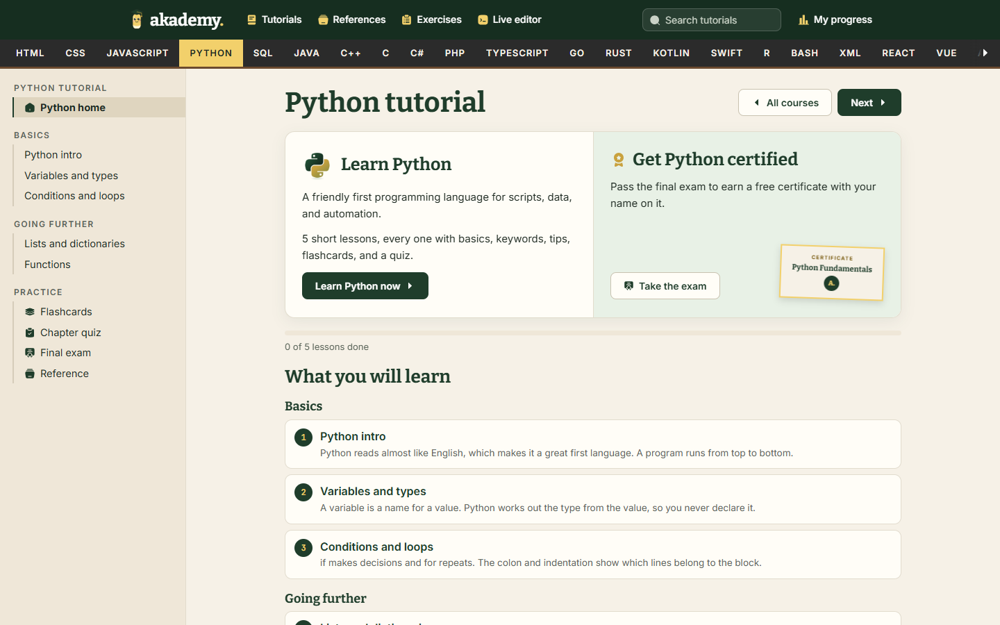
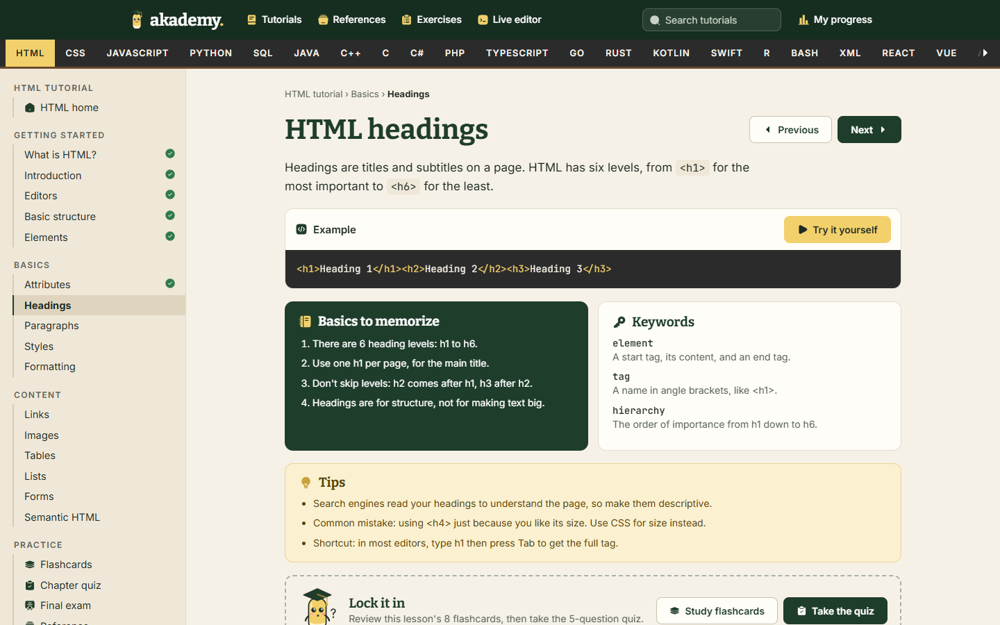
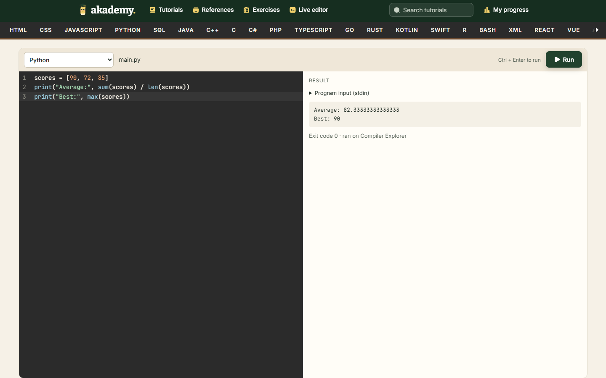
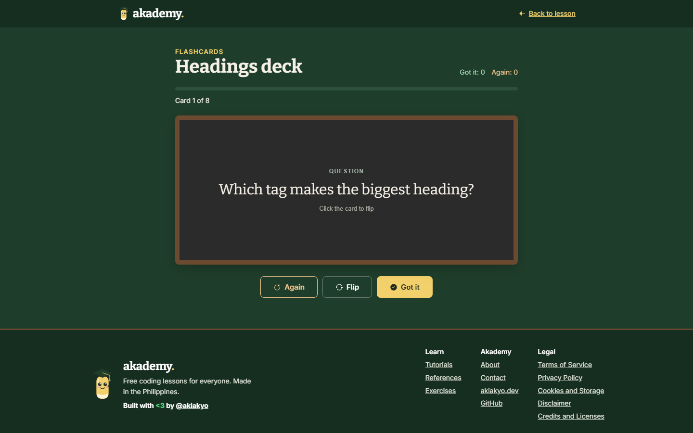
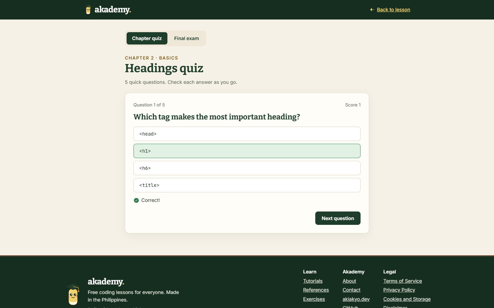
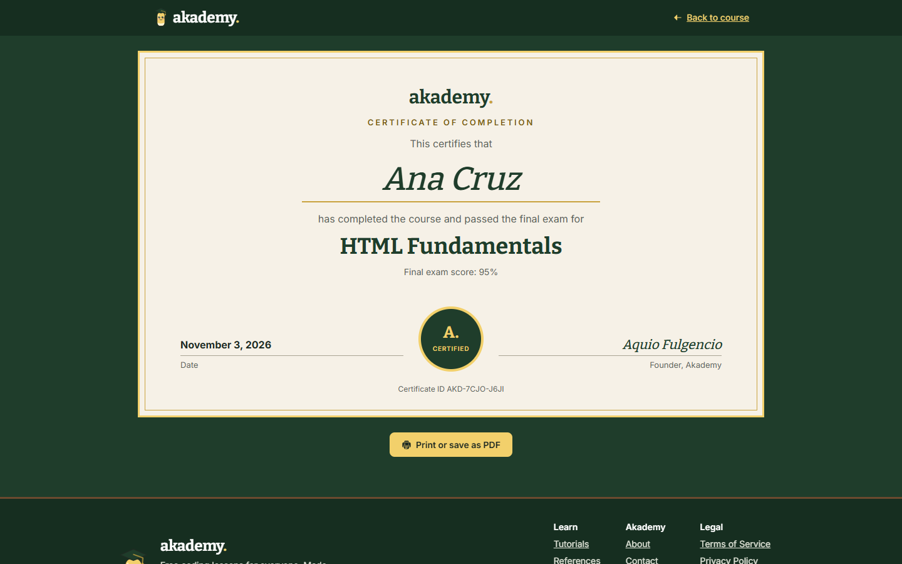

<p align="center">
  
</p>

<h1 align="center">akademy.</h1>

<p align="center">
  <b>Learn to code, one lesson at a time.</b><br>
  Free coding tutorials with a chalkboard theme, live compilers, flashcards, quizzes, and certificates.
</p>

<p align="center">
  
  
  
  
  
</p>



## What is Akademy?

Akademy is a free place to learn programming, made in the Philippines. Every lesson is short, written in plain language, and sits right next to an editor where you can change the code and run it. Aky, our chalk mascot, cheers you on along the way.

There is nothing to install and no account to create.

## Features

- **34 courses:** HTML, CSS, JavaScript, TypeScript, Python, Java, C, C++, C#, PHP, Go, Rust, Kotlin, Swift, R, Bash, SQL, React, Vue, Angular, Node.js, Django, and more
- **Live editor:** run code in 19 language modes from your browser
- **Study tools in every lesson:** basics to memorize, keywords, tips and common mistakes
- **Flashcards:** flip each card, then mark it Got it or Again
- **Chapter quizzes and final exams:** check your answers as you go
- **Certificates:** pass a final exam to earn a printable certificate with your name on it
- **Progress tracking:** saved in your own browser, with no sign-in

## Showcase

### Course pages



### Lessons



### Live editor



### Flashcards and quizzes

| Flashcards | Quizzes |
| --- | --- |
|  |  |

### Certificates



## How to use Akademy

1. **Pick a subject** from the bar at the top of any page.
2. **Read a lesson.** Each one covers a single idea.
3. **Press Try it yourself** to open the example in the live editor. Change the code, then press **Run** or Ctrl + Enter.
4. **Lock it in** with the lesson's flashcards and quiz.
5. **Press Next** to record the lesson in **My progress**.
6. **Add your name** on your profile page so it appears on your certificates.
7. **Take the final exam.** Score 70% or higher to earn your certificate, then print it or save it as a PDF.

The **Reference** button on each course gathers all of its keywords, basics, and tips on one page.

## Run it on your computer

You need [Node.js](https://nodejs.org) 20.9 or newer.

```bash
git clone https://github.com/akiakyo/akademy.git
cd akademy
npm install
npm run dev
```

Open <http://localhost:3000>. No API keys or environment variables are needed.

| Command | What it does |
| --- | --- |
| `npm run dev` | Starts the development server |
| `npm run build` | Builds the site for production |
| `npm start` | Serves the production build |
| `npm run lint` | Checks the code with ESLint |
| `npm run check:examples` | Runs the lesson examples through the live compilers, with the app running |

## Add or edit lessons

Lessons are plain data in `src/content/`, in `html.ts`, `web.ts`, `languages.ts`, and `data.ts`. A new lesson only needs an entry in its course. New courses also go in the `COURSES` list in `src/content/index.ts`.

Quiz questions list the correct answer first. The options are shuffled when shown.

## How code runs

| Where | Languages |
| --- | --- |
| Your browser | HTML, CSS, JavaScript, browser frameworks (sandboxed iframe), SQL (sql.js), NumPy and pandas (Pyodide) |
| Compiler Explorer, with Wandbox as backup | Python, C, C++, Rust, Go, Java, C#, Ruby |
| Compiler Explorer only | Swift |
| Kotlin Playground, with Compiler Explorer as backup | Kotlin |
| Wandbox only | PHP, R, TypeScript, Bash, Node.js |

Server-side runs go through `src/app/api/run/route.ts` and `src/lib/execute.ts`. These are free community services with no uptime promise. Wandbox allows about six runs in a burst per server, then pauses, so `execute.ts` retries after a delay. For heavy traffic, host your own engine and add it as a backend in `execute.ts`.

## Deploy

Copy `.env.example` to `.env.local` and set `NEXT_PUBLIC_SITE_URL` to your domain, then rebuild. The sitemap, `robots.txt`, and canonical links are built from it.

To add the site to Google Search Console, verify it with `NEXT_PUBLIC_GOOGLE_SITE_VERIFICATION` or DNS, then submit `https://your-domain.com/sitemap.xml`.

## Project assets

- Run `node scripts/build-logos.mjs` to regenerate the subject logos from [Devicon](https://github.com/devicons/devicon) (MIT) in the site palette. The logos remain trademarks of their owners.
- Interface icons come from the [Solar](https://www.figma.com/community/file/1166831539721848736) set by 480 Design (CC BY 4.0), Bold style only. To add one, edit `scripts/build-icons.mjs` and run it.

## Author

Built with <3 by [@akiakyo](https://github.com/akiakyo). Find more at [akiakyo.dev](https://akiakyo.dev).
